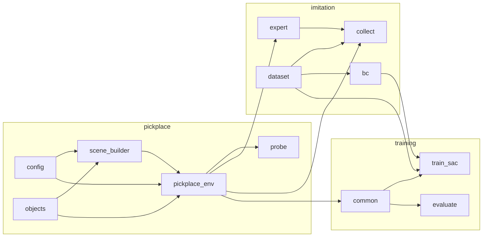
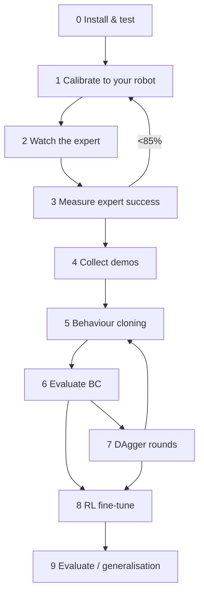

# Sysmic pick-and-place — architecture & workflow

This is the "start here" document. It explains the big picture, the vocabulary of RL (written for a first-time
RL user, with every term mapped to a place in the code), how the three packages fit together, and the exact
workflow from "fresh checkout" to "trained policy".

Detailed per-package references:

| Package | Doc | One-line purpose |
|---|---|---|
| `sysmic_rl.pickplace` | [pickplace.md](pickplace.md) | The *world*: scene, objects, the Gym environment, reward, calibration probe |
| `sysmic_rl.imitation` | [imitation.md](imitation.md) | The *teacher*: scripted expert, demo recording, behaviour cloning, DAgger |
| `sysmic_rl.training` | [training.md](training.md) | The *learner*: SAC setup, fine-tuning from demos, evaluation |

---

## 1. The problem in plain language

We have a simulated two-armed robot on a lift. We want a **policy** (a neural network) that, given what the robot
can sense, outputs joint commands that pick up a plate / glass / bowl / mug and put it at a goal spot on a table.

Learning that from scratch by trial and error (reinforcement learning, RL) is slow because the robot must
accidentally stumble into a successful grasp before it learns anything. So we do two things:

1. Write a **scripted expert** that can already do the task (it cheats: it reads the simulator's exact state).
2. Let the neural network **copy the expert** first (imitation learning), then **improve beyond it by trial and error** (RL fine-tuning).

```
 scripted expert ──demos──► behaviour cloning ──initial policy──► RL fine-tuning ──► final policy
   (cheats, slow to tune)     (supervised learning)                 (SAC, trial & error)
```

---

## 2. RL vocabulary, mapped to this code

| Term | Meaning | Where it lives here |
|---|---|---|
| **Environment** | The simulated world. You give it an action, it returns what happened. | `pickplace/pickplace_env.py` → `SysmicPickPlaceEnv` |
| **Observation** (`obs`) | The vector of numbers the policy sees (joint angles, object pose, goal, …). 86 numbers. | `_obs_parts()` in the env; layout in `env.obs_layout` |
| **Action** | The vector the policy outputs: 13 numbers in [-1, 1] (lift + 2 arms × 6 joints). Each is "move this joint target a bit". | `step()` in the env |
| **Reward** | A number after every step saying how well things are going. RL maximises the *sum* of rewards. | `_reward_and_flags()`; weights in `RewardConfig` |
| **Step / Episode** | One policy decision (20 ms of sim) / one attempt at the task (≤ 400 steps). | `step()` / `reset()` |
| **Terminated / Truncated** | Episode ended because it *succeeded or failed* / because it *ran out of time*. SAC treats them differently. | return values of `step()` |
| **Policy** (actor) | The network obs → action. This is what we are training. | SB3 SAC `model.actor` |
| **Critic** (Q-function) | A second network that estimates "how much total reward will I get if I take this action here?". Used only during training. | SB3 SAC `model.critic` |
| **Replay buffer** | Memory of past `(obs, action, reward, next_obs, done)` transitions that SAC re-learns from. | `model.replay_buffer`; pre-filled in `training/train_sac.py` |
| **Off-policy (SAC)** | Can learn from old data and from demos, not just from the current policy's own experience. Why we can inject demos. | SB3 `SAC` |
| **Entropy / exploration** | SAC deliberately keeps its actions a bit random so it keeps exploring. `ent_coef` controls how much. | `ent_coef="auto_0.01"` in `training/common.py` |
| **Dense vs sparse reward** | Dense = small hints every step (we use this); sparse = only reward on success (hard to learn). | `RewardConfig` |
| **Behaviour cloning (BC)** | Plain supervised learning: make the policy output what the expert output in the same state. | `imitation/bc.py` |
| **Distribution shift / DAgger** | A cloned policy drifts into states the expert never showed. DAgger fixes this by letting the policy drive and asking the expert "what would you do here?". | `imitation/collect.py --policy` |
| **Domain randomisation** | Randomising friction, mass, positions so the policy doesn't overfit one setup. | `TaskConfig.randomize_physics`, `reset()` |
| **Seed** | Number making randomness reproducible. | `env.reset(seed=...)` |

**The one-sentence mental model:** the environment is a function `(state, action) → (next obs, reward, done)`;
the training code just calls it millions of times and nudges the network toward actions that lead to more reward.

---

## 3. Package map

```
src/sysmic_rl/
├── pickplace/            THE WORLD (no learning code, no torch)
│   ├── config.py         every tunable number (dataclasses)
│   ├── objects.py        procedural plate/bowl/glass/mug geometry
│   ├── scene_builder.py  writes the scene XML that <include>s your robot
│   ├── pickplace_env.py  the Gymnasium environment (the heart)
│   └── probe.py          calibration report for YOUR robot's geometry
│
├── imitation/            THE TEACHER
│   ├── expert.py         scripted privileged expert (IK + state machine)
│   ├── dataset.py        HDF5 read/write of demonstrations
│   ├── collect.py        run expert (optionally mixed with a policy = DAgger) → demos file
│   └── bc.py             supervised pre-training of the SAC actor
│
└── training/             THE LEARNER (needs stable-baselines3 / torch)
    ├── common.py         env factory + SAC constructor
    ├── train_sac.py      demo-seeded SAC fine-tuning
    └── evaluate.py       success-rate measurement for any policy

tests/                    pytest suite + a mesh-free stub robot
docs/                     these documents
```

### Dependency rules (keep these when you edit)



* `pickplace` depends on **nothing else** in the project (only MuJoCo/Gymnasium/NumPy). You can test it without torch.
* `imitation` depends on `pickplace`. `bc.py` additionally needs torch.
* `training` depends on both and on stable-baselines3.
* Never import `training` from `pickplace` — it would make the world depend on the learner.

---

## 4. What happens during one environment step

This is the most useful thing to understand if you want to change behaviour.

```
policy output a (13 numbers in [-1,1])
 │ 1. clip to [-1,1], multiply by action_mask      → the inactive arm is forced to 0
 │ 2. EMA smoothing                                → smooth = 0.25*a + 0.75*previous_smooth  (removes jitter)
 │ 3. target = target + smooth * per-joint scale   → "move the position target a little"
 │ 4. clamp target to [qpos ± max_lag] and joint limits (anti-windup: target can't run away from the real joint)
 │ 5. 10 × { interpolate ctrl toward target ; mj_step }    → 10 × 2 ms = 20 ms (50 Hz control)
 ▼
 read new state → build observation (86-D) → compute reward terms → check success / failure / timeout
 ▼
 return (obs, reward, terminated, truncated, info)
```

The robot is **position-controlled**: MuJoCo's position actuators (kp=200) chase `ctrl`. The policy never
outputs torques — it nudges targets. This is the same scheme as your original `SysmicV2Env`.

---

## 5. The workflow, stage by stage

Each stage has **inputs → command → outputs → how to know it worked**. Do not skip ahead: later stages hide
earlier problems.



### Stage 0 — install and smoke test
```bash
uv add stable-baselines3 h5py tensorboard
uv add --dev pytest
uv run pytest
```
Checks the code works on a fake robot (`tests/stub_robot.py`). **Success:** `7 passed`.

### Stage 1 — calibrate (the most important stage)
```bash
uv run python -m sysmic_rl.pickplace.probe --robot-xml mjcf/<your_robot>.xml
```
Prints the reachable region, which gripper angle is open/closed, and rest-pose contacts. Then edit
`pickplace/config.py`: `table_top_z`, `spawn_x/y`, `gripper_open_q`, `gripper_close_q`, `arm_home`,
and each `ArmSpec.grasp_offset`. See [pickplace.md §Calibration](pickplace.md#calibration).
**Success:** objects spawn inside the envelope; you know which gripper angle is "open".

### Stage 2 — look at it
```bash
uv run python -m sysmic_rl.training.evaluate --expert --episodes 3 --render
```
Opens the MuJoCo viewer. **Check by eye:** is the red goal sphere on the table? Does the gripper end up around
the object? Does it close on it? If the grasp point is visibly off, tune `grasp_offset`.

### Stage 3 — measure the expert
```bash
uv run python -m sysmic_rl.training.evaluate --expert --episodes 100
```
**Success:** ≥ 85 % overall, no object below ~60 %. If not, tune `ExpertConfig` or geometry
([imitation.md §Tuning the expert](imitation.md#tuning-the-expert)). Everything downstream copies the expert, so
a 40 %-expert gives a 40 %-ceiling.

### Stage 4 — collect demonstrations
```bash
uv run python -m sysmic_rl.imitation.collect --episodes 300 --noise 0.1 --out data/demos.h5
```
Output: `data/demos.h5` (only successful episodes are kept). **Success:** ≥ 200 stored episodes, all four objects represented.

### Stage 5 — behaviour cloning
```bash
uv run python -m sysmic_rl.imitation.bc --demos data/demos.h5 --out runs/bc
```
Output: `runs/bc/bc_sac.zip` (a full SAC model whose *actor* is trained; critic is still random).
**Success:** the printed `val_mse` decreases and plateaus (a few ×1e-3 or lower is typical, but it depends on your data).

### Stage 6 — evaluate the clone
```bash
uv run python -m sysmic_rl.training.evaluate --model runs/bc/bc_sac.zip --episodes 100
```
**Expectation:** clearly worse than the expert (e.g. 30–60 %). That gap is normal and is what DAgger closes.

### Stage 7 — DAgger (optional but recommended; repeat 2–3×)
```bash
uv run python -m sysmic_rl.imitation.collect --episodes 100 --policy runs/bc/bc_sac.zip --beta 0.3 --out data/dagger1.h5
uv run python -m sysmic_rl.imitation.bc --demos data/demos.h5 data/dagger1.h5 --out runs/bc2
```
`--beta` = probability that the *expert* drives each step (the policy drives the rest). Lower beta in later rounds.

### Stage 8 — RL fine-tuning
```bash
uv run python -m sysmic_rl.training.train_sac --demos data/demos.h5 data/dagger1.h5 \
    --init runs/bc2/bc_sac.zip --out runs/sac
tensorboard --logdir runs
```
Run takes hours. **Success:** `eval/success_rate` in TensorBoard starts near the BC level and climbs; it should
not crash to zero in the first 50 k steps (if it does, see [training.md §Troubleshooting](training.md#troubleshooting)).

### Stage 9 — final evaluation
```bash
uv run python -m sysmic_rl.training.evaluate --model runs/sac/best_model.zip --episodes 200
```
Per-object and per-arm success rates are printed.

---

## 6. Files and folders the workflow creates

| Path | Created by | Contents | Safe to delete? |
|---|---|---|---|
| `mjcf/scene_pickplace.generated.xml` | `scene_builder` (every env construction) | table + objects + `<include>` of your robot | yes (regenerated) |
| `data/*.h5` | `collect.py` | demonstrations | only if you can re-collect |
| `runs/bc*/bc_sac.zip` | `bc.py` | BC-pretrained SAC model | yes |
| `runs/sac/` | `train_sac.py` | TensorBoard logs, `sac_*_steps.zip` checkpoints, `best_model.zip`, `evaluations.npz`, `final.zip` | keep `best_model.zip` |

---

## 7. "I want to change X — where do I go?"

| I want to… | Edit | Then you must… |
|---|---|---|
| Move/resize the table, change spawn area | `SceneConfig` in `config.py` | re-run probe + stage 2 |
| Change gripper angles / home pose | `TaskConfig` | re-run stage 3 onward |
| Add or edit an object (shape, size, mass) | `objects.py` (+ `SceneConfig.objects`) | **re-collect demos & retrain** (obs size changes if you add an object) |
| Change what is rewarded | `RewardConfig` / `_reward_and_flags()` | **re-collect demos** (they store old rewards) and restart RL |
| Change how fast joints move | `TaskConfig.*_action_scale`, `ema_alpha` | re-collect demos & retrain |
| Add something to the observation | `_obs_parts()` | **everything downstream is invalidated** (dims change) |
| Make the expert better | `ExpertConfig` / `expert.py` | re-collect demos |
| Change network size | `net` in `training/common.py:build_sac` | retrain (BC checkpoints won't load into a different size) |
| Change algorithm hyper-parameters | `training/common.py:build_sac` | restart RL |
| Make episodes longer | `TaskConfig.max_episode_steps` | re-collect demos |

### Compatibility rules (read once, save hours)

A saved artefact is only valid for the code it was made with:

* **Demos (`.h5`)** contain observations (86-D), rewards, and actions made under specific settings. Change the
  observation, the reward, the action scales, the object list, or the physics scene → re-collect.
* **Model zips** have fixed input/output sizes and network width. Change obs size or `net` → retrain.
* When in doubt, delete `data/` and `runs/` and redo stages 4–8. Stage 4 takes minutes.

---

## 8. Reading the training curves

Run `tensorboard --logdir runs`. The ones that matter:

| Curve | Healthy | Worrying |
|---|---|---|
| `eval/success_rate` | trending up | flat at 0 after ≥ 300 k steps, or collapses early |
| `eval/mean_reward` | trending up | up while success stays 0 → the agent exploits a reward term (see below) |
| `rollout/ep_rew_mean` | trending up (noisy) | — |
| `train/critic_loss` | bounded | exploding → reward scale too big |
| `train/ent_coef` | slowly decreasing | stuck high → exploration noise drowning the policy |

**Reward hacking:** if reward rises but success doesn't, print `info["reward_terms"]` during a rollout and see which
term the agent farms (e.g. hovering near the object collects `reach` forever). Fix by rebalancing `RewardConfig`.

---

## 9. Common problems

| Symptom | Likely cause | Fix |
|---|---|---|
| `FileNotFoundError: Robot MJCF not found` | wrong robot path | `--robot-xml …` or `export SYSMIC_ROBOT_XML=…` |
| Expert gets stuck in `pre`/`approach` | target unreachable | probe → move table/spawn closer, lower `table_top_z` |
| Expert grasps but object slips | friction / grip force / wrong gripper sign | check `gripper_close_q`; add pad geoms; raise friction |
| `n_bad_contacts` always > 0 | rest-pose mesh overlap | probe lists them; they're auto-ignored at home pose, otherwise add `<exclude>` to your MJCF |
| BC val loss fine, rollouts bad | distribution shift | DAgger rounds, more demos with `--noise 0.1`–`0.2` |
| RL destroys the BC policy at the start | random critic | longer `--warmup`, smaller `ent_init`, lower learning rate |
| Shape mismatch loading a checkpoint | obs/net changed | retrain (see §7) |

---

## 10. Scope & limitations (honest status)

* Built and smoke-tested on a mesh-free stub robot; **calibration on your real robot is required** before the expert works.
* The torch/SB3 scripts (`bc.py`, `train_sac.py`, `common.py`) were not executed during development — expect small fixes.
* State-based observations (perfect object pose). Vision would be a later distillation step.
* One environment instance per training run (demo pre-fill assumes it).
* Fixed base — the wheels are not used.
